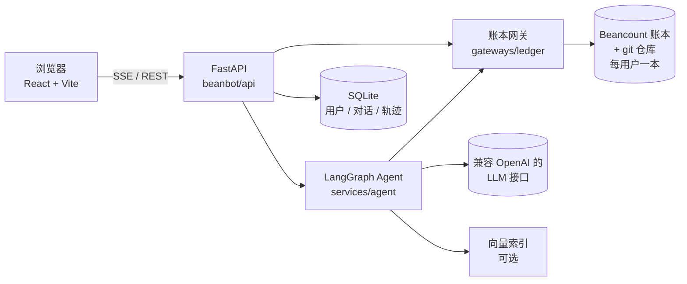
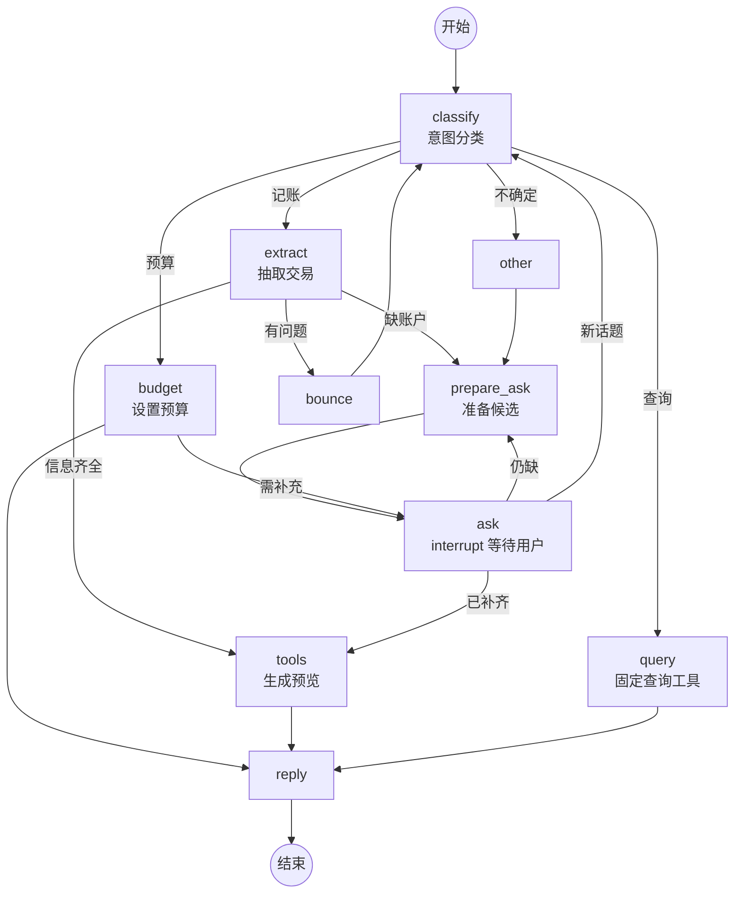

<div align="center">

# 🌿 LedgerSage

**用一句话记账，把自然语言变成可审计的 Beancount 复式账本**

[](https://www.python.org/)
[](https://fastapi.tiangolo.com/)
[](https://github.com/langchain-ai/langgraph)
[](https://github.com/beancount/beancount)
[](https://react.dev/)
[](LICENSE)

</div>

---

## 📖 简介

LedgerSage 是一个多用户的**对话式记账** Web 应用。你只需要像聊天一样说「中午火锅 128，微信付的」，它就会：

1. 判断你是想**记账、查询还是设预算**；
2. 抽取金额、日期、商户和资金流向，信息不全时**主动追问**；
3. 把将要写入的 Beancount 分录**以 diff 形式给你预览**，确认后才落盘；
4. 每次写入都生成一个 **git commit**，随时可以撤销。

**账本文件是账务数据的唯一真源。** 每个用户拥有一本独立的、由 git 管理的 Beancount 纯文本账本；SQLite 只保存用户、对话、LangGraph checkpoint 与决策轨迹，不保存任何账务数字。

## ✨ 功能特性

### 💬 对话记账
- **两阶段理解**：先分类意图，再抽取交易，低置信度时追问而不是瞎猜（ADR 0001）
- **主动追问**：缺账户时基于商户历史和全局使用频率给出候选按钮，用 LangGraph `interrupt` 实现可恢复的多轮对话（ADR 0007）
- **多笔批量**：「早饭 12、地铁 4、午饭 35」一次识别多笔，整批原子写入（ADR 0010）
- **先预览后落盘**：写入前展示 diff 卡与校验结果，确认卡上可以直接改账户（ADR 0012、0015）
- **汇总账户不可记账**：`Expenses:Food` 这类有子账户的账户只用于报表和预算，记账只落在末级账户（ADR 0016）
- **相似样例检索**：可选的每用户向量索引，把历史分录作为 few-shot 示例喂给模型

### 🔍 确定性查询
- 「这个月吃饭花了多少」「最贵的三笔」「微信还剩多少」
- LLM 只从固定工具中选择并填写参数，**不生成 BQL**，结果可验证（ADR 0006）
- 内置工具：`query_transactions`（支持分组汇总、按金额排序）、`get_balance`、`list_accounts`、`budget_status`
- 常用问题可以保存为快捷查询

### 📊 统计与报表
- **仪表盘**：资产 / 负债卡片、近六月支出趋势、分类合计、Top 收款方
- **收支表**：收入、支出两棵账户树 × 连续多个月的发生额矩阵，带储蓄率、月度构成、迷你趋势条，点格子下钻到流水
- **资产负债**：期末余额、净资产、资产配置
- **流水**：按时间、账户前缀、收款方筛选，支持查看原文与删除

### 💰 预算
- 用一句话设置周 / 月 / 年预算，以 Beancount `custom "budget"` 指令存进账本（ADR 0008）
- 汇总账户可直接挂预算，统计时包含全部子孙账户

### 🛡️ 可审计与安全
- **纯追加写入**，只 stage 目标文件，每次写入一个 git commit（ADR 0002、0003）
- 记账、预算、删除都可以通过 commit **一键撤销**（ADR 0013）
- 每次 Agent 运行的**决策轨迹**完整保留，可回放
- 账本健康度体检：独立检查磁盘上的账本，损坏时也能给出可读报告
- 邀请码注册 + JWT 鉴权，用户之间账本完全隔离（ADR 0005）

## 🏗️ 架构



### Agent 流程



### 目录结构

```text
beanbot/
├── api/                 # FastAPI 路由：鉴权、对话 SSE、仪表盘、报表、运行历史
├── services/
│   ├── agent/           # LangGraph 图：分类、抽取、追问、查询、预算与候选选择
│   ├── chat_service.py  # 对话流式输出与运行记录
│   ├── pending_service.py # 待确认写入：预览、改账户、确认、拒绝
│   └── vector_index.py  # 每用户增量向量索引
├── gateways/ledger/     # 所有 Beancount 与 git I/O：加载、聚合、追加写、撤销
├── storage/             # 带版本号迁移的 SQLite 业务表
└── cli.py               # 命令行入口
web/                     # React + Vite + TypeScript 前端
tests/                   # pytest 测试；tests/eval/ 为手动运行的真实模型评测
docs/adr/                # 架构决策记录
CONTEXT.md               # 领域术语表
```

## 🚀 快速开始

### 环境要求

| 依赖 | 版本 |
| --- | --- |
| Python | 3.12+ |
| Node.js | 20+ |
| pnpm | 用于前端依赖与开发服务器 |
| git | 账本版本管理必需 |

### 1. 配置环境变量

```bash
cp .env.example .env
```

编辑 `.env`，以下字段**必填**，缺失时应用会在启动阶段列出：

| 变量 | 说明 |
| --- | --- |
| `JWT_SECRET` | JWT 签名密钥，至少 32 个字符 |
| `INVITE_CODE` | 注册用的初始邀请码 |
| `LLM_BASE_URL` | 兼容 OpenAI 的接口地址 |
| `LLM_API_KEY` | 模型 API Key |
| `LLM_MODEL` | 模型名称 |

<details>
<summary>可选配置</summary>

| 变量 | 默认值 | 说明 |
| --- | --- | --- |
| `DATA_DIR` | `./data` | SQLite 数据目录 |
| `LEDGER_ROOT` | `./data/ledgers` | 用户账本根目录 |
| `EMBEDDING_ENABLED` | `false` | 是否启用向量检索 |
| `EMBEDDING_BASE_URL` / `EMBEDDING_API_KEY` / `EMBEDDING_MODEL` | — | 兼容 OpenAI 的 embeddings 端点 |
| `EMBEDDING_BATCH_SIZE` | `32` | 单次 embedding 请求条数 |
| `CONFIDENCE_THRESHOLD` | `0.8` | 自动补全账户的置信度阈值 |
| `CLARIFICATION_CANDIDATE_LIMIT` | `12` | 追问时最多给出的候选数 |
| `CONVERSATION_TITLE_MAX_LENGTH` | `40` | 对话标题上限 |
| `CONVERSATION_TITLE_AUTO_LENGTH` | `10` | 自动标题截取字数 |
| `LEDGER_CONTEXT_LINES` | `5` | diff 卡上文行数 |
| `LEDGER_HISTORY_LIMIT` | `10` | 右栏写入历史条数 |

完整说明见 [`.env.example`](.env.example)。

</details>

### 2. 安装依赖

```bash
python -m venv .venv
.venv/bin/pip install -r requirements-dev.txt
cd web && pnpm install && cd ..
```

### 3. 启动

**开发模式**（前端 Vite 热更新 + 后端自动重载）：

```bash
.venv/bin/python -m beanbot dev
```

**生产模式**（后端直接托管构建好的前端）：

```bash
cd web && pnpm run build && cd ..
.venv/bin/python -m beanbot serve
```

打开 <http://localhost:8000>，用 `INVITE_CODE` 注册第一个账号。系统会自动为你生成一本带常用账户的初始账本。

### 🐳 Docker

```bash
docker compose up --build
```

镜像会构建前端、安装 git，并以单 worker 启动。`beanchat-ledgers` 卷是账务数据的唯一真源，**上线前务必配置外部备份**。

## 🛠️ 命令行

| 命令 | 说明 |
| --- | --- |
| `python -m beanbot serve [--host] [--port]` | 启动 Web 服务 |
| `python -m beanbot dev [--port]` | 同时启动前端开发服务器与后端 |
| `python -m beanbot invite --count 3` | 生成邀请码 |
| `python -m beanbot migrate-account-names <账本> [--apply]` | 把写在行尾注释里的显示名迁移到 `open` 的 `name:`，默认只预览 |
| `python -m beanbot format <账本或文件>` | 手动对账本跑一次 `bean-format` |

> 迁移显示名前请先提交干净的工作区。脚本只修改有效的 `open` 行，加载校验失败会恢复文件，并输出完整改动清单。

## 🧪 测试与检查

```bash
.venv/bin/python -m pytest          # 全部后端测试，不需要 API Key
.venv/bin/python -m mypy beanbot    # 类型检查
cd web && pnpm run build            # 前端类型检查 + 构建
```

真实模型的意图分类评测需要手动运行：

```bash
.venv/bin/python -m tests.eval.classify
```

## 📐 设计原则

- **账本即真源**：账务数字只来自 Beancount 文件，任何报表都由账本现算
- **LLM 只做理解，不做计算**：查询走固定工具，报表是确定性聚合，不经过 Agent
- **先确认后写入**：模型的输出永远先变成可编辑的预览，用户确认才落盘
- **一切可撤销**：每次写入都是一个 git commit
- **单 worker 串行写**：每本账本一把进程内锁，Uvicorn 必须保持 `--workers 1`，多 worker 无法共享锁，可能丢失并发写入

完整的决策过程见 [`docs/adr/`](docs/adr/)，领域术语（发生额、汇总账户、储蓄率等）见 [`CONTEXT.md`](CONTEXT.md)。

<details>
<summary>架构决策记录一览</summary>

| 编号 | 决策 |
| --- | --- |
| 0001 | 先分类再抽取的两阶段流程 |
| 0002 | 纯追加写入，单 worker |
| 0003 | 用 git 管理账本 |
| 0004 | 置信度来源 |
| 0005 | 多用户，每人一本账本 |
| 0006 | 固定查询工具，不生成 BQL |
| 0007 | 用 LangGraph interrupt 实现追问 |
| 0008 | 预算用 custom 指令存储 |
| 0009 | 账户显示名写在 meta 中 |
| 0010 | 多笔交易批次原子写入 |
| 0011 | 用 pydantic-settings 管理配置 |
| 0012 | 两阶段写入：先确认再提交 |
| 0013 | 删除交易会重写账本 |
| 0014 | 用分录行表达资金流向 |
| 0015 | 自动补全必须可编辑 |
| 0016 | 汇总账户不能直接记账 |

</details>

## 📄 许可证

本项目基于 [MIT License](LICENSE) 开源。
